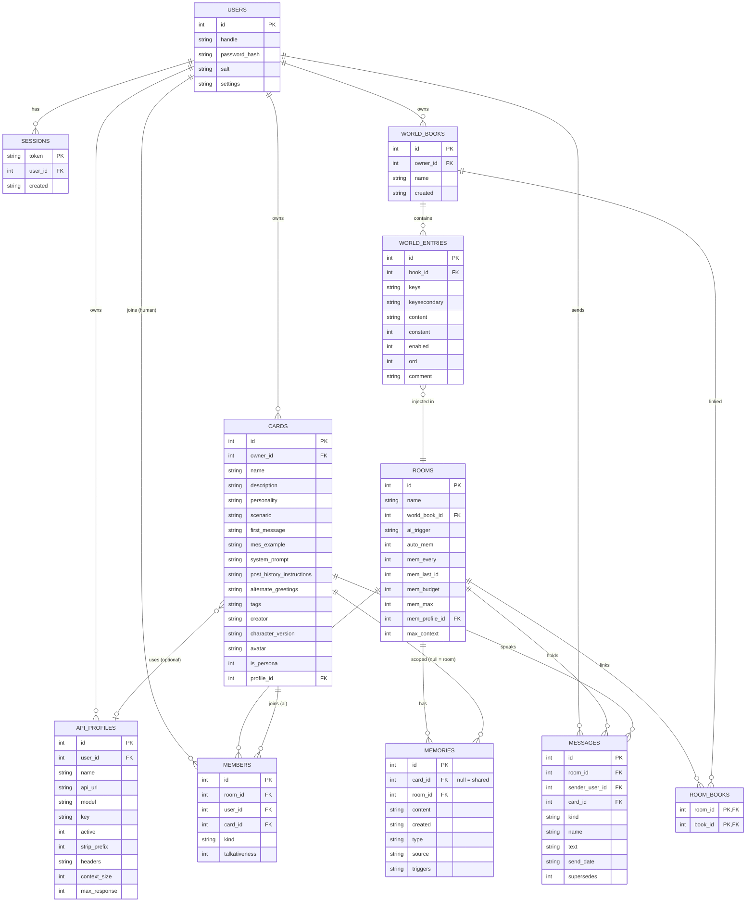

# What is BOLLOCKS?

**Bots' Own Lore Logic & Open Chat Konversation System**

- Group chat that allows a mixture of AI and humans while maintaining control over your own AI character's API key and personality

## Why over SillyTavern?

- SillyTavern is great for single character interactions, but BOLLOCKS is designed for group chat with multiple AI characters and humans

## Why the rebuild rather than extending SillyTavern?

- SillyTavern is a dumb backend that relies on the frontend to do all the work. This is OK if you are wanting to run the server on a potato however the frontend is very heavy and slow.
- BOLLOCKS uses a SQLite database for all data storage, making it much faster and more reliable.
- ST's chat is a JSON file appended per message. Two humans writing at once is last-write-wins — one save clobbers the other's messages, and multi-account "mirror" chats were an attampted hack on top of that, not a fix.
- True multiplayer needs a real database as source of truth, server-side auth and ownership, and thin clients — none of which bolt onto ST cleanly without fighting the file model.

## Features

- **Group chat** with multiple AI characters and humans in one room
- **Control over your own AI character's API key and personality** — every profile is per-user; cards can pick a profile or fall back to the room default
- **Personas** — your own player character; your messages carry its name and avatar
- **Import existing SillyTavern characters** (V1/V2/V3 PNG + JSON) **and LoreBooks**
- **World books** — keyword-triggered and constant lore entries, linkable per chat
- **Memories** — permanent (manual, per-character or shared) and smart (AI-extracted room memories with type tags and trigger keywords)
- **AI activation** — manual / every message / named / round-robin, plus per-member talkativeness
- **Context caps** — per-chat and per-profile token limits; history middle-trims to fit
- **Live updates** — messages, deletions and memory extraction stream to all clients

# Nerdy Details

## Tech Stack

- **Backend** — Node.js ES modules, built-in `http` server, no framework
- **Database** — SQLite via `node:sqlite`, embedded file in `data/app.db`
- **Frontend** — plain HTML/JS pages + shared layout shell (`layout.js/css`), no build step
- **Realtime** — Server-Sent Events (`/api/stream`) for message/delete broadcasts
- **Generation** — OpenAI-compatible `chat/completions`; per-profile URL/key/model, custom headers, context size, max response

## Infrastructure

Single SQLite file alongside the code. Schema:

- **users** — accounts (handle, password hash/salt)
- **sessions** — bearer tokens
- **rooms** — chats (`ai_trigger`, `auto_mem`, `mem_every`, `mem_budget`, `mem_max`, `mem_profile_id`, `max_context`, `world_book_id`)
- **members** — room roster (human `user_id` or AI `card_id`, `talkativeness`)
- **cards** — characters (owner, ST fields, `is_persona`, `profile_id`, `avatar`)
- **api_profiles** — connections (`api_url`, `model`, `key`, `active`, `headers`, `context_size`, `max_response`)
- **world_books / world_entries** — lorebooks (keys, secondary keys, constant, order, enabled)
- **messages** — chat log (`room_id`, `sender_user_id`, `card_id`, `name`, `text`, `kind`)
- **memories** — `room_id` + nullable `card_id` (NULL = shared house memory), `type`, `source` (manual/auto), `triggers`
