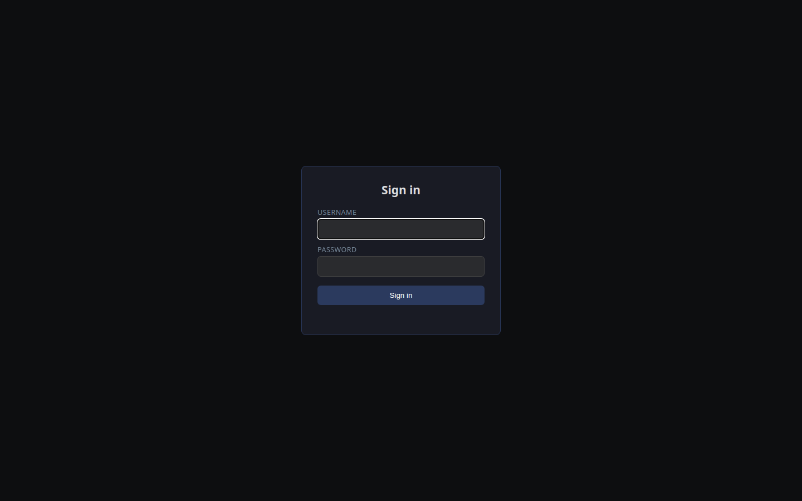
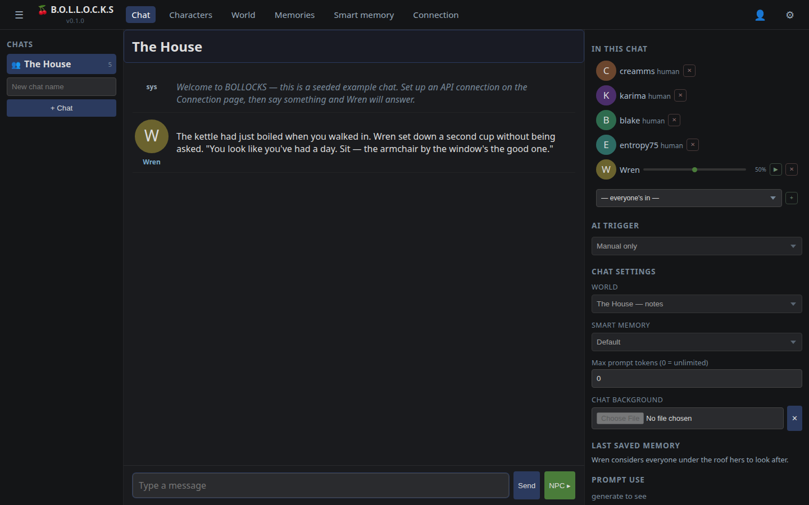
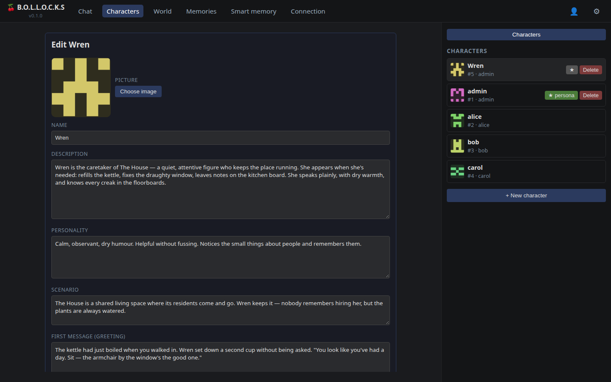
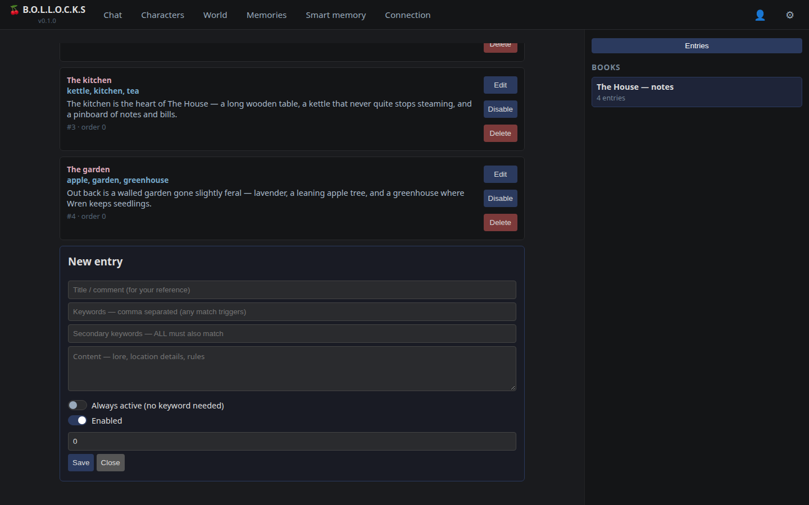
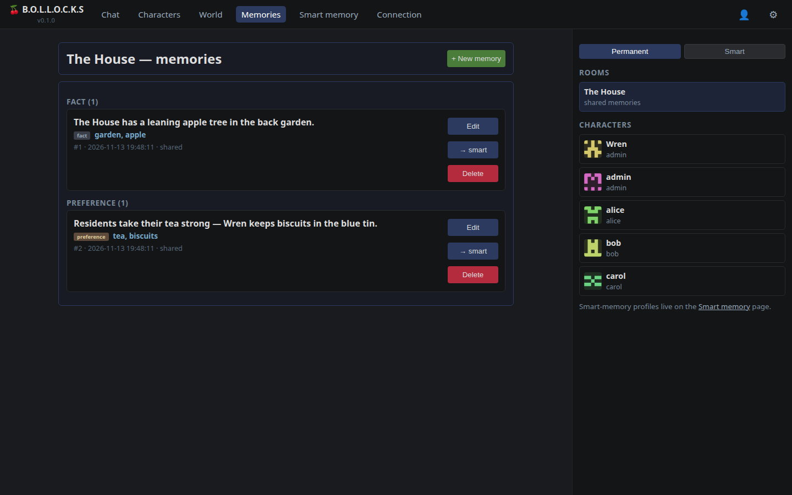
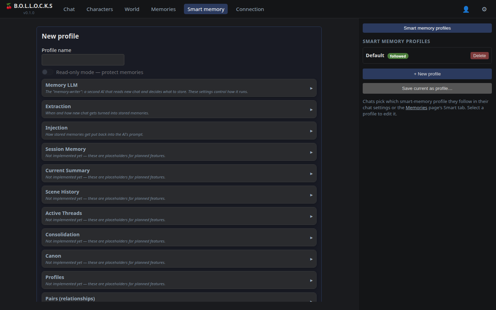
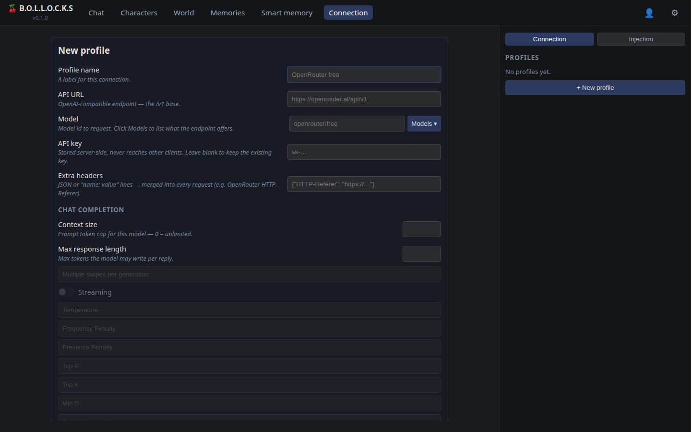
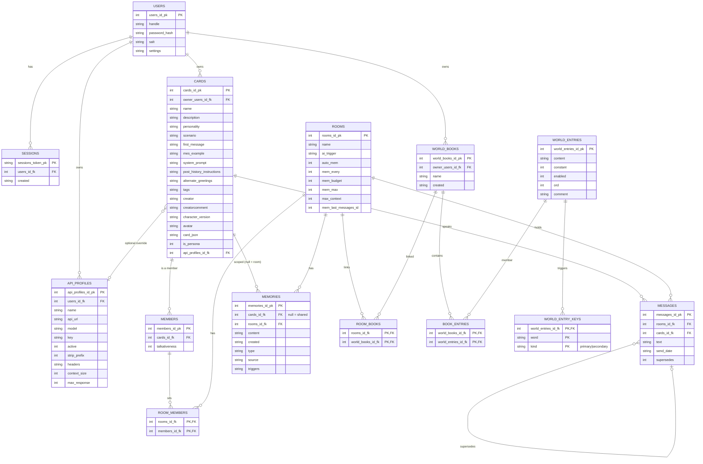

# What is BOLLOCKS?

**Bots' Own Lore Logic & Open Chat Konversation System**

- Group chat that allows a mixture of AI and humans while maintaining control over your own AI character's API key and personality

## Why over SillyTavern?

- SillyTavern is great for single character interactions, but BOLLOCKS is designed for group chat with multiple AI characters and humans

## Why the rebuild rather than extending SillyTavern?

- SillyTavern is a dumb backend that relies on the frontend to do all the work. This is OK if you are wanting to run the server on a potato however the frontend is very heavy and slow.
- BOLLOCKS uses a SQLite database for all data storage, making it much faster and more reliable.
- ST's chat is a JSON file appended per message. Two humans writing at once is last-write-wins — one save clobbers the other's messages, and multi-account "mirror" chats were an attampted hack on top of that, not a fix.
- True multiplayer needs a real database as source of truth, server-side auth and ownership, and thin clients — none of which bolt onto ST cleanly without fighting the file model.

## Features

- **Group chat** with multiple AI characters and humans in one room
- **Control over your own AI character's API key and personality** — every profile is per-user; cards can pick a profile or fall back to the room default
- **Personas** — your own player character; your messages carry its name and avatar
- **Import existing SillyTavern characters** (V1/V2/V3 PNG + JSON) **and LoreBooks**
- **World books** — keyword-triggered and constant lore entries, linkable per chat
- **Memories** — permanent (manual, per-character or shared) and smart (AI-extracted room memories with type tags and trigger keywords)
- **AI activation** — manual / every message / named / round-robin, plus per-member talkativeness
- **Context caps** — per-chat and per-profile token limits; history middle-trims to fit
- **Live updates** — messages, deletions and memory extraction stream to all clients

# Getting started

```bash
npm install
npm start          # http://localhost:8100
```

First run seeds a demo: four demo users (`admin` — the site admin — plus `alice`, `bob`, `carol`, all password `changeme`), a chat called **The House** with the character **Wren** seated in it, a linked lorebook, and some example memories — so there's something to click through straight away. Skip it with `BOLLOCKS_SEED=0` and register your own account instead.

To actually generate replies, sign in and set up an API connection on the **Connection** page (any OpenAI-compatible endpoint works).

# The tour

## Sign in

Everything behind the login page is gated — no session, no app.



## Chat

The room you're in, who's in it, and who's listening. The right sidebar holds the AI trigger mode, chat settings (linked world book, memory profile, context cap, background), the last memory the AI saved, and prompt-token use. `NPC ▸` asks an AI member to reply.



## Characters

Your card collection — SillyTavern V1/V2/V3 PNGs and JSON import straight in. Each card carries its own personality fields and can pin an API profile, or fall back to your default.



## World

Lorebooks. Pick a book in the sidebar and its entries show as full cards — title, trigger keywords, content, order — with edit-in-place. Entries reach the AI when their keywords come up in a chat the book is linked to.



## Memories

Two kinds: **Permanent** memories you write yourself (shared with the room, or scoped to one character), and **Smart** memories the AI extracts from the conversation on its own. Type tags and trigger keywords show on each card; smart memories can be promoted to permanent.



## Smart memory

The dials for the extraction side: which connection profile does the reading, how often it runs, caps per memory type, injection budget. Saved as named profiles a room can follow.



## Connection

Two tabs. **Connection** is the OpenAI-compatible endpoint — URL, model, key (kept server-side), extra headers, context and response caps. **Injection** is prompt assembly: which blocks go into the system prompt and in what order.



# Nerdy Details

## Tech Stack

- **Backend** — Node.js ES modules, built-in `http` server, no framework
- **Database** — SQLite via `node:sqlite`, embedded file in `data/app.db`
- **Frontend** — plain HTML/JS pages + shared layout shell (`layout.js/css`), no build step
- **Realtime** — Server-Sent Events (`/api/stream`) for message/delete broadcasts
- **Generation** — OpenAI-compatible `chat/completions`; per-profile URL/key/model, custom headers, context size, max response

## Infrastructure

Single SQLite file alongside the code. Schema:



- **users** — accounts (`handle`, `password_hash`/`salt`)
- **sessions** — bearer tokens (`sessions_token_pk`)
- **api_profiles** — connections (`api_url`, `model`, `key`, `active`, `headers`, `context_size`, `max_response`)
- **cards** — characters (owner, ST fields, `is_persona`, `api_profiles_id_fk` override, `avatar`)
- **members** — a card's seat: `cards_id_fk` + `talkativeness` (persona card = human)
- **room_members** — junction: which members sit in which rooms
- **rooms** — chats (`ai_trigger`, `auto_mem`, `mem_every`, `mem_budget`, `mem_max`, `max_context`, `mem_last_messages_id`)
- **messages** — chat log (`rooms_id_fk`, `cards_id_fk` sender, `text`, `supersedes`)
- **memories** — `cards_id_fk` nullable (NULL = shared room memory), `type`, `source` (manual/auto), `triggers`
- **world_books** — lorebooks (owner, name)
- **room_books** — junction: which books feed which rooms
- **world_entries** — lore entries (`content`, `constant`, `enabled`, `ord`, `comment`)
- **world_entry_keys** — trigger keywords (`word`, `kind` primary|secondary)
- **book_entries** — junction: which entries live in which books