# What is BOLLOCKS?

**Bots' Own Lore Logic & Open Chat Konversation System**

- Group chat that allows a mixture of AI and humans while maintaining control over your own AI character's API key and personality

## Why over SillyTavern?

- SillyTavern is great for single character interactions, but BOLLOCKS is designed for group chat with multiple AI characters and humans

## Why the rebuild rather than extending SillyTavern?

- SillyTavern is a dumb backend that relies on the frontend to do all the work. This is OK if you are wanting to run the server on a potato however the frontend is very heavy and slow.
- BOLLOCKS uses a SQLite database for all data storage, making it much faster and more reliable.
- ST's chat is a JSON file appended per message. Two humans writing at once is last-write-wins — one save clobbers the other's messages, and multi-account "mirror" chats were an attampted hack on top of that, not a fix.
- True multiplayer needs a real database as source of truth, server-side auth and ownership, and thin clients — none of which bolt onto ST cleanly without fighting the file model.

## Features

- **Group chat** with multiple AI characters and humans in one room
- **Control over your own AI character's API key and personality** — every profile is per-user; cards can pin a profile or fall back to their owner's active one
- **Personas** — your own player character; your messages carry its name and avatar
- **Import existing SillyTavern characters** (V1/V2/V3 PNG + JSON) **and LoreBooks**
- **World books** — keyword-triggered and constant lore entries, linkable per chat
- **Memories** — manual (per-character or shared) and smart (AI-extracted room memories with type tags and trigger keywords); a memory with no triggers is canon — always injected
- **Story threads** — room-scoped arcs the extraction pass opens/updates/closes, or you manage by hand; injected while open
- **AI activation** — manual / every message / named / round-robin, plus per-member talkativeness
- **Context caps** — per-chat and per-profile token limits; history middle-trims to fit
- **Live updates** — messages, deletions and memory extraction stream to all clients
- **Prompt transparency** — per-block token inspector in the chat sidebar, and a per-room log of the last 50 prompts/responses actually sent to the LLM

# Getting started

```bash
npm install
npm start          # http://localhost:8100
```

Environment overrides: `PORT` for the listen port, `BOLLOCKS_DATA` for the data directory (database + avatars + backgrounds — point a local dev server at a copied prod `data/` for realistic testing), `BOLLOCKS_SEED=0` to skip seeding.

Dev commands: `npm test` (route + generation suites against mock LLMs), `npm run lint`.

First run seeds a demo: four demo users (`admin` — the site admin — plus `alice`, `bob`, `carol`, all password `changeme`), a chat called **The House** with the character **Wren** seated in it, a linked lorebook, and some example memories — so there's something to click through straight away. Skip it with `BOLLOCKS_SEED=0` and register your own account instead.

To actually generate replies, sign in and set up an API connection on the **Connection** page (any OpenAI-compatible endpoint works).

# The tour

## Sign in

Everything behind the login page is gated — no session, no app.

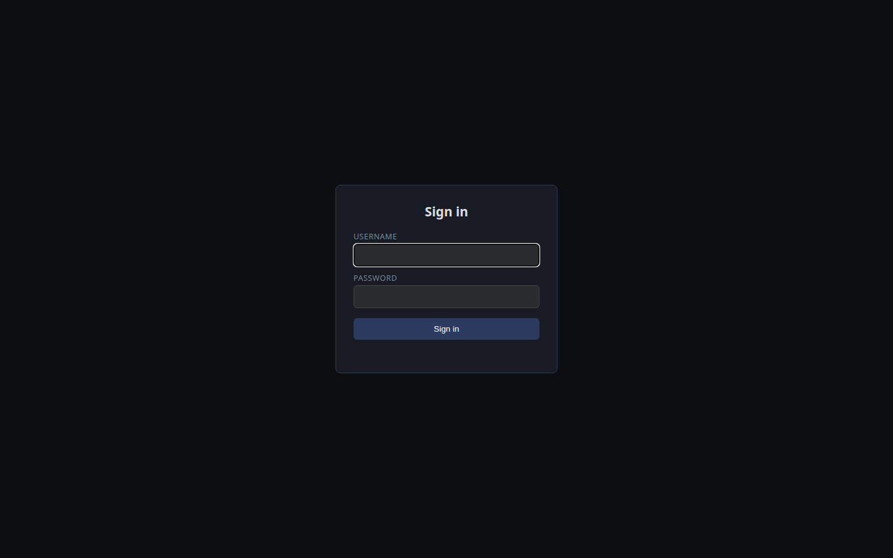

## Chat

The room you're in, who's in it, and who's listening. The right sidebar holds the AI trigger mode, chat settings (linked world book, memory profile, context cap, background), the last memory the AI saved, and prompt-token use. `NPC ▸` asks an AI member to reply.

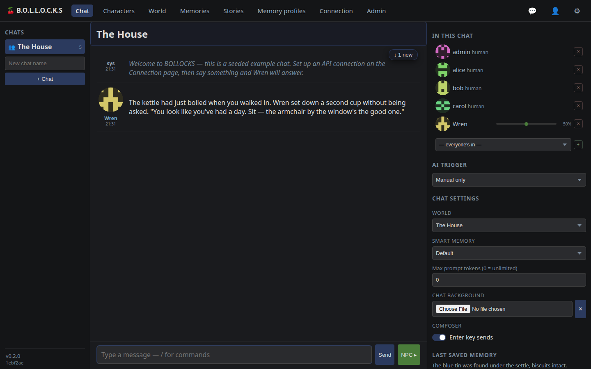

## Characters

Your card collection — SillyTavern V1/V2/V3 PNGs and JSON import straight in. Each card carries its own personality fields and can pin an API profile, or fall back to your default.

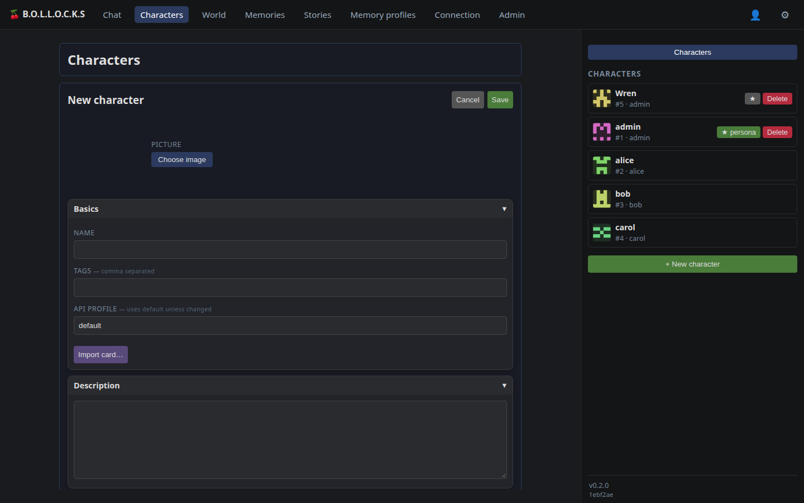

## World

Lorebooks. Pick a book in the sidebar and its entries show as full cards — title, trigger keywords, content, order — with edit-in-place. Entries reach the AI when their keywords come up in a chat the book is linked to.

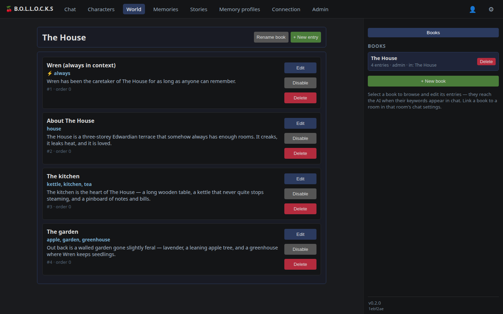

## Memories

Two tabs: **Manual** — memories you write yourself (shared with the room, or scoped to one character) — and **Smart** — what the extraction pass has learned in the picked chat. Type tags and trigger keywords show on each card; clearing the keywords makes a memory canon (always in the prompt). Smart memories can be promoted to manual.

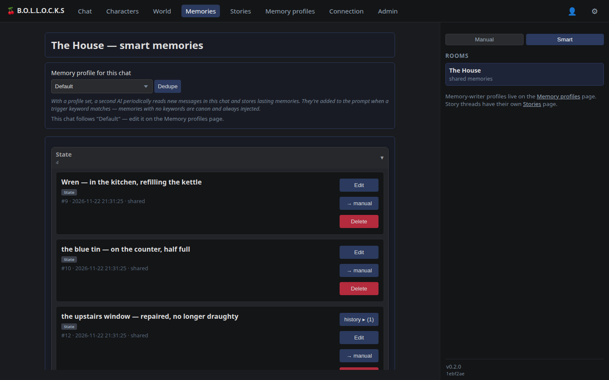

## Stories

Room-scoped story threads, Manual/Smart tabs again — opened by you or by extraction. Open threads stay in every prompt until resolved or dropped; the extraction pass can open, update and close them on its own.

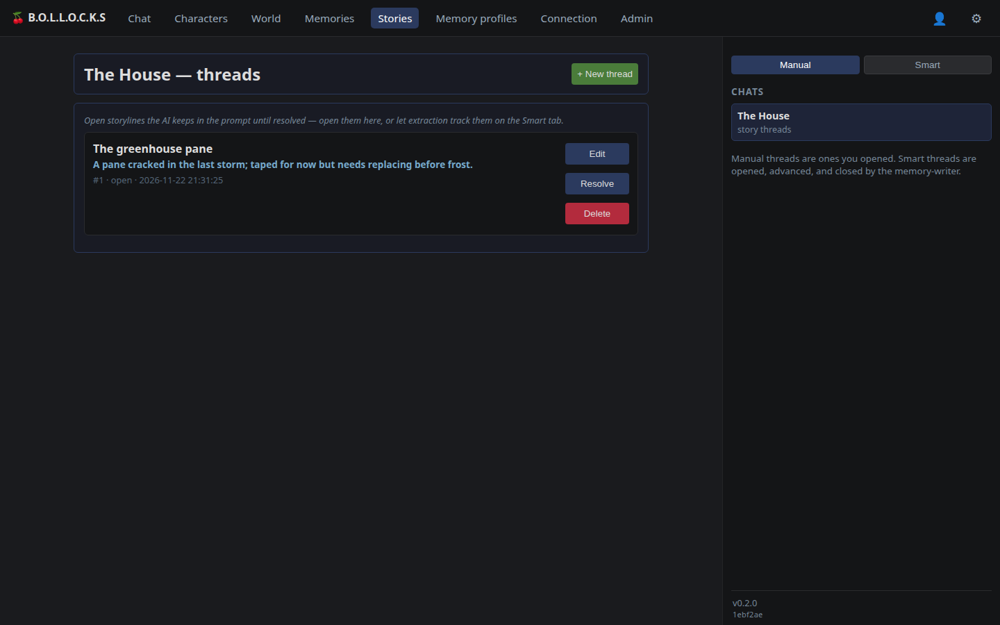

## Memory profiles

The dials for the extraction side: which connection profile does the reading, how often it runs, caps per memory type, injection budgets, thread tracking. Saved as named profiles a room can follow — following a profile is what switches smart memories on.

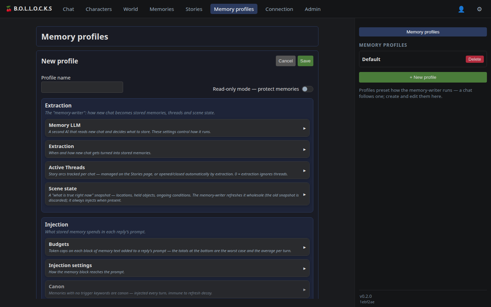

## Connection

Two tabs. **Connection** is the OpenAI-compatible endpoint — URL, model, key (kept server-side), extra headers, context and response caps. **Injection** is prompt assembly: which blocks go into the system prompt and in what order.

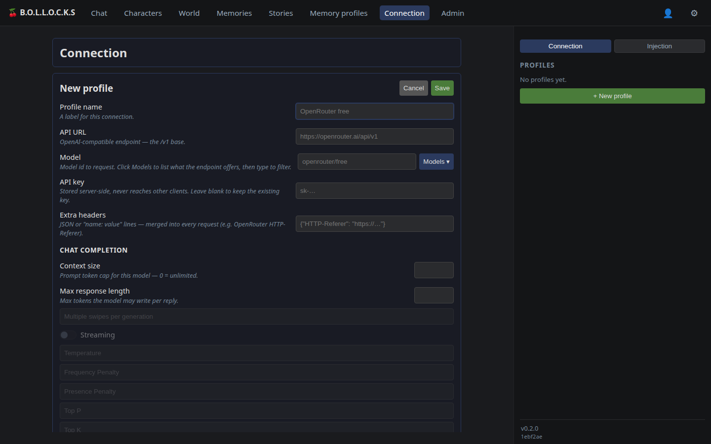

# Where it's going

User management, a proper room settings view, smarter memory organization and more — see [docs/roadmap.md](docs/roadmap.md).

# Nerdy Details

## Tech Stack

- **Backend** — Node.js ES modules, built-in `http` server, no framework
- **Database** — SQLite via `node:sqlite`, embedded file in `data/app.db`
- **Frontend** — plain HTML/JS pages + shared layout shell (`layout.js/css`), no build step
- **Realtime** — Server-Sent Events (`/api/stream`) for message/delete broadcasts
- **Generation** — OpenAI-compatible `chat/completions`; per-profile URL/key/model, custom headers, context size, max response

## Infrastructure

Single SQLite file alongside the code. Schema:

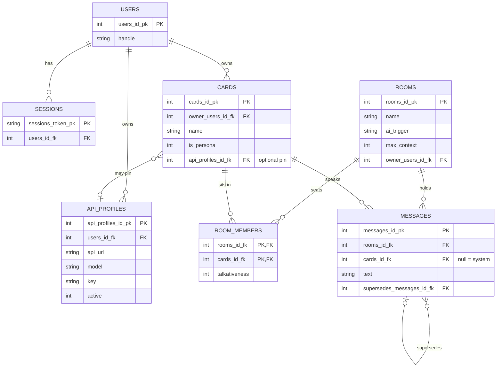

### Memory & stories

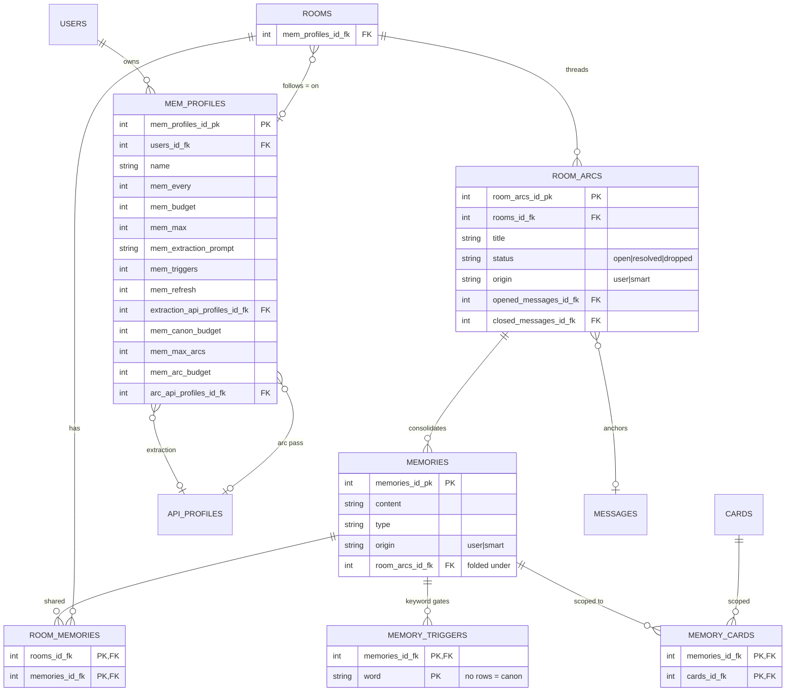

### Lore

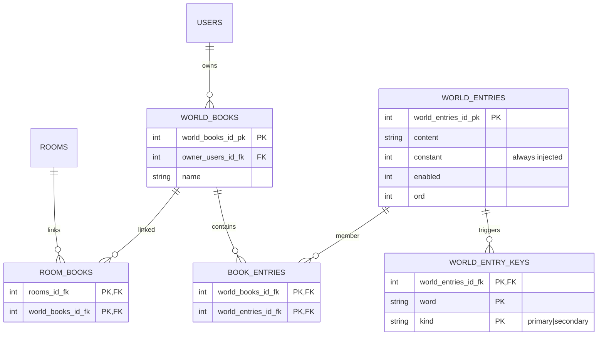

### Prompt plumbing

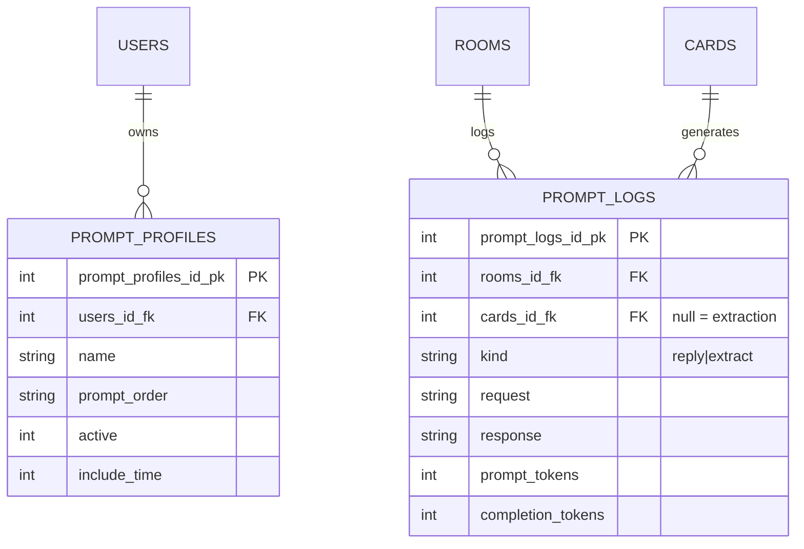
- **users** — accounts (`handle`, `password_hash`/`salt`)
- **sessions** — bearer tokens (`sessions_token_pk`)
- **api_profiles** — connections (`api_url`, `model`, `key`, `active`, `headers`, `context_size`, `max_response`)
- **cards** — characters (owner, ST fields, `is_persona`, `api_profiles_id_fk` override, `avatar`)
- **room_members** — junction: which cards sit in which rooms, with per-room `talkativeness` (persona card = human)
- **rooms** — chats (`ai_trigger`, `max_context`, `bg`, `mem_profiles_id_fk` → the memory profile it follows, `owner_users_id_fk`, `mem_last_messages_id_fk` extraction watermark + `mem_refresh_count`)
- **messages** — chat log (`rooms_id_fk`, `cards_id_fk` sender, `text`, `supersedes_messages_id_fk` edit chain)
- **memories** — facts shared via junctions, not room/card columns: `type` (fact/event/relationship/preference), `origin` (`user` manual vs `smart` extracted); no `memory_triggers` rows = canon (always injected)
- **room_memories** — junction: which memories a room can inject
- **memory_cards** — junction: narrows a memory to one character (unlinked = room-shared)
- **memory_triggers** — one row per trigger keyword; keyword-gates injection
- **room_arcs** — story threads (`status` open/resolved/dropped, `origin` user/smart, message anchors); open threads inject on every reply; on close the arc's span is summarized and its smart memories fold under it (`memories.room_arcs_id_fk`), re-emerging via `Earlier events:` when re-evoked
- **mem_profiles** — named memory presets a room follows (following = on): extraction cadence/model/prompt, per-type caps, canon + thread budgets, extraction/arc connection pickers
- **prompt_profiles** — named prompt-assembly presets (`prompt_order` block sequence, `active`)
- **prompt_logs** — newest 50 LLM calls per room (`kind` reply|extract, request JSON, raw response, token usage) — the prompt inspector's durable half
- **world_books** — lorebooks (owner, name)
- **room_books** — junction: which books feed which rooms
- **world_entries** — lore entries (`content`, `constant`, `enabled`, `ord`, `comment`)
- **world_entry_keys** — trigger keywords (`word`, `kind` primary|secondary)
- **book_entries** — junction: which entries live in which books