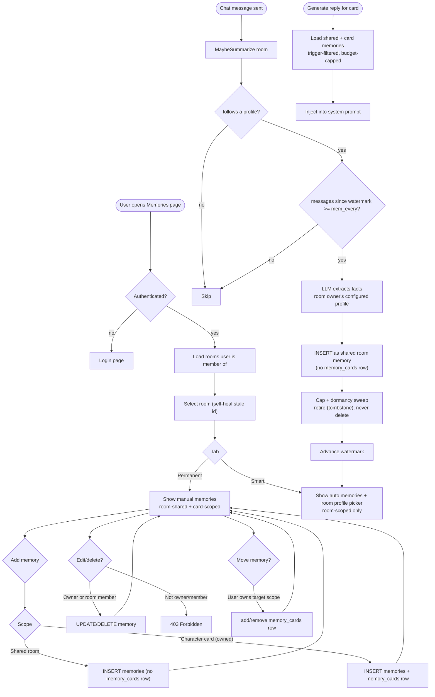
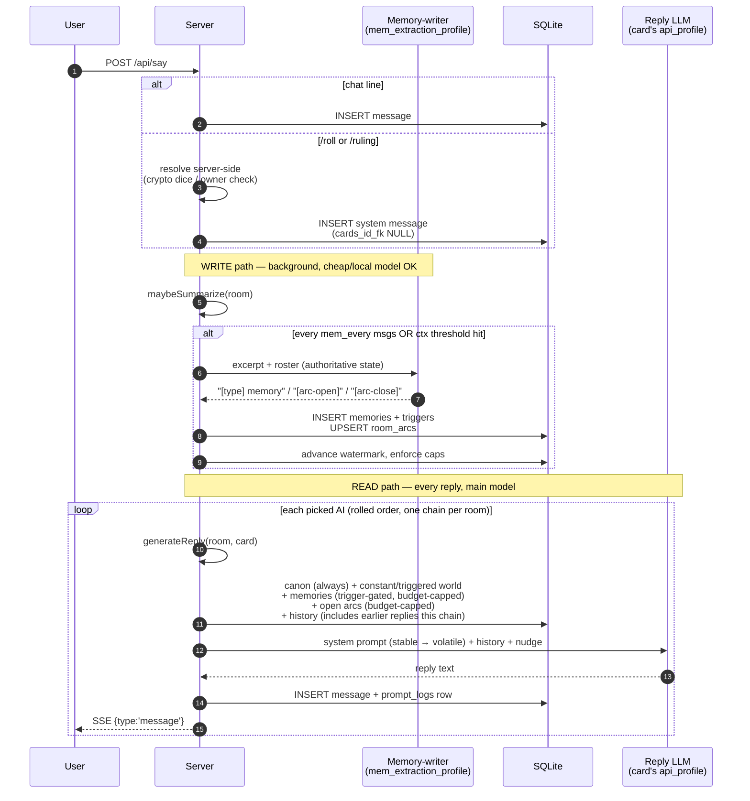

# Memories — Design & Flow

This document describes how the memories system in BOLLOCKS works, who can do
what, and the intended refinements. It accompanies the code in `src/db.js`,
`src/server.js`, `src/generate.js` (injection), `src/memwriter.js` (extraction),
`public/memories.html`, and `public/app.js`.

## Concepts

There are two kinds of memory, distinguished by `origin`:

| Kind | `origin` | Created by | Scope | Lifetime |
|---|---|---|---|---|
| **Permanent** | `user` | User (always user-driven) | Room-shared or character (card) | Until user deletes it |
| **Smart** | `smart` | AI extraction | **Room only** (shared) | Capped (`mem_max`) / dormant — auto-**retired**, never deleted |

### Permanent memories (user-driven)

- Created explicitly by a user through the Memories UI or API.
- `type` defaults to `fact`; user can set `fact` / `event` / `relationship` / `preference`.
- Trigger keywords live as `memory_triggers` rows (one per word, lowercase); no rows = always inject, otherwise keyword-gated. The API speaks comma-separated strings at the boundary.
- Matching is whole-word over the full fetched history + the generating card's fields (`wordHit` in `generate.js`, shared with world entries): `"king"` fires on `"kings"`/`"king's"` but not inside `"looking"`. No substring matching.
- **Ownership / edit rights:**
  - A user may edit/delete **character memories** for cards they **own** (`cards.owner_users_id_fk === user`).
  - A user may edit/delete **room (shared) memories** for any room they are a **member of**.
  - Permanent memories are never auto-created, never auto-capped, never auto-deleted.
- Card-scoped permanent memories travel with that character **within the room(s)** they were created in (linked via `room_memories` + `memory_cards`).

### Smart memories (AI-extracted)

- Created automatically by `maybeSummarize()` after every `mem_every` messages, when the room follows a profile.
- **Profile link:** a room follows a smart-memory profile via `rooms.mem_profiles_id_fk` — **the link itself is the on/off switch** (the profile dropdown; the old `auto_mem` column has been dropped). Profiles stay user-owned presets (`mem_profiles.users_id_fk`); a room may only follow a profile owned by the room's owner, and only the room owner can change the link (`POST /api/room/memsettings`). No link → smart memories are **off** (no fallback to a default profile). Deleting a profile re-points only the owner's own rooms at another of their profiles.
- Extraction runs only through the room owner's configured extraction profile (`extraction_api_profiles_id_fk` on the memory profile). No fallback: if it is unset, missing, or belongs to someone other than the room owner, extraction is skipped.
- **Smart memories belong to the chat (room) only** - they are always stored as shared room memories (no `memory_cards` row).
  - Rationale: deciding whether an extracted fact belongs to a specific character vs. the chat as a whole is ambiguous and error-prone. Keep smart memories room-scoped; users can promote a fact to a character's permanent memory manually if desired.
- Capped to `mem_max` per room (oldest live `origin='smart'` rows **retire** — see Retirement below). Under cap pressure the room runs a **consolidation sweep first** (`dedupeRoom` — merges retold events into chains) so duplicates free slots before any real memory retires. Permanent memories are never subject to the cap.
- **Dormancy pruning:** with `mem_prune_messages > 0` on the profile (new profiles default to 50; existing profiles stay 0/off after upgrade), a triggered smart memory that hasn't reached a prompt within the last N room messages retires itself. Injection stamps `last_fired_messages_id_fk` + `last_fired_at` on every memory that actually makes the prompt (budget-capped rows that never make the cut are precisely what the sweep retires). A memory gets the full window from creation before it can be retired. Canon (no triggers) is exempt — always injected by design — as are `state` rows, folded arc rows, and permanent memories.
- Watermark (`mem_last_messages_id_fk`) advances only after a successful extraction.

## Scoping model

```
memory (memories)  -- standalone entity; no room/card FKs
├── origin  'user' | 'smart'
├── room_memories (junction, many-to-many)  -- which chats this memory is available in
│   └── rooms_id_fk → room
└── memory_cards (junction, many-to-many)  -- which characters this memory belongs to
    └── cards_id_fk → card (character memory; absent => shared room memory)
```

- A memory is **shared room memory** iff it has no `memory_cards` row.
- A memory is **character memory** iff it has one or more `memory_cards` rows.
- A memory can span multiple rooms (cross-chat) and multiple cards.
- Smart memories are room-scoped (linked to one room) by design.

Injection at generation time (see `generateReply`):
1. Shared room memories (no `memory_cards` row, trigger-filtered, budget-capped).
2. This card's own memories (linked via `memory_cards`, trigger-filtered, budget-capped against remaining budget).
3. Budget = `mem_budget` on the room's followed `mem_profiles` row.

## Ownership & permissions

| Action | Permanent (manual) | Smart (auto) |
|---|---|---|
| Create | User (via UI/API) | System (extraction) |
| Read | Room members / card owners | Room members |
| Edit content/type/triggers | Card owner or room member | Room member |
| Delete | Card owner or room member | Room member (or auto-capped) |
| Move between scopes (card ↔ shared) | User (via move) | No |

**Room membership** is determined by `room_members` (junction) plus the room's existence. A user is considered a member of a room if they appear in `room_members` for that room, or are the room owner/creator.

## Flow chart



## API contract (intended)

| Endpoint | Method | Auth | Notes |
|---|---|---|---|
| `/api/memories?card=&room=` | GET | user | List memories. `card=-1` all in room; `card=0` shared only; `card>0` that card. |
| `/api/memories` | POST | user + ownership | Create. `{cardId, room, content, type?, triggers?}`. `cardId=0`/null = shared. Requires card ownership or room membership. |
| `/api/memories/delete` | POST | user + ownership | `{id}`. Delete if owner/member. |
| `/api/memories/update` | POST | user + ownership | `{id, content?, type?, triggers?}`. |
| `/api/memories/move` | POST | user + ownership | `{id, cardId}`. Move between card and shared. |
| `/api/room/memsettings` | POST | room owner only | `{room, memProfile}`. Point the room at one of the owner's own `mem_profiles` (0 clears). |
| `/api/lastmem?room=` | GET | user | Latest `origin='smart'` memory in room. |

## Known issues

Tracked on GitHub rather than in this doc — see the
[issue list](https://github.com/XanthiaJo/BOLLOCKS/issues). The historical
list that used to live here was stale on review: the `world_books_id_pk`
fallback ([#149](https://github.com/XanthiaJo/BOLLOCKS/issues/149)) and the
`updated`/`owner` audit columns ([#150](https://github.com/XanthiaJo/BOLLOCKS/issues/150))
are still open; the auth gaps, trigger filter, `set_profile`, and
`type`/`triggers` acceptance were all fixed since.

## Open design questions

- Should permanent card memories be visible across rooms if the same card is in multiple rooms? Currently scoped per room. Leaning: keep per-room (matches smart memories; avoids cross-room leakage).
- Should smart memories ever be attributed to a character? Decided no — room-scoped only, to avoid ambiguity. Users can promote manually.
- "Global character memory" (ST-style) — deferred, tracked as [#144](https://github.com/XanthiaJo/BOLLOCKS/issues/144).

## Canon & arcs

The `.ph` sections on the Memory profiles settings page sketch a richer
memory system. Two of them — **canon** and **arcs** — are implemented
end-to-end. UI structure: the Memories page has **Manual** (permanent) and
**Smart** (extracted) tabs, and story threads live on their own **Stories**
page with the same Manual/Smart split (by who opened them). Designed for
minimal API cost.

Terms: **canon** = always-true facts ("never contradict this") — defined
mechanically as a memory with **no trigger keywords**, not a flag; **arcs** =
open story threads with a lifecycle ("this is unfolding — advance it").
Canon is static; arcs open, progress, close.

**Scene state** = `type='state'` smart memories holding a "what is true
right now" snapshot — locations, held objects, ongoing conditions. A
dedicated memory-writer pass (`mem_state` on the profile, every
`mem_state_every` extraction runs, paced by `rooms.mem_extract_count`)
emits the scene as a **keyed JSON set** — one `subject → state` entry per
thing worth tracking (`{"Wren":"in the kitchen","blue tin":"on the
counter"}`) — and the script owns the diff against the **live** rows
(`superseded_by IS NULL`, keyed by `memories.state_key`): a subject's new
value stores a fresh row and points the old row's `superseded_by` at it,
subjects absent from the set are retracted as tombstones
(`superseded_by = self` — retired with no successor), unchanged entries
keep their rows. Contradictory states can't stack — the live set is
always exactly one row per subject, and the superseded chain is the
subject's history (browsable per entry in the State accordion). The model
sees the current set so it carries unchanged keys forward. State rows
carry no triggers, never fold into arcs, are excluded from the canon query
and the global `mem_max` cap, and inject as their own `Scene:` prompt
block (capped by `mem_state_budget`).

**Supersede** = `memories.superseded_by_memories_id_fk` marks a smart
memory retired by a newer one. The extraction prompt lists the room's
current smart memories numbered; a bullet written `- [supersede N]
new fact` stores the new memory and points the old row at it. Untagged
retellings are caught anyway: each new smart `event` is compared against
the room's live events by IDF-weighted trigger overlap (`memdedupe.js`,
shared rare words count, ubiquitous room vocabulary doesn't) and scores
above `DEDUPE_MIN` chain the same way — `POST /api/memories/dedupe`
re-runs that sweep pairwise for cleanup. Retellings the scorer can't see
(fully paraphrased triggers) fall to the optional **LLM sweep**
(`mem_sweep`/`mem_sweep_every` on the memory profile —
[#141](https://github.com/XanthiaJo/BOLLOCKS/issues/141)): every N
extraction runs the model reviews the live list and emits
multi-`[supersede N]` merge lines. Or drag one live card onto another
on the Memories page — `POST /api/memories/link` merges the two chains
with the newest-`created` head staying live. The inverse works too:
drag a dimmed history card out of a chain and `POST /api/memories/unlink`
detaches it back to live (or re-points it under a target's head when
dropped on another card). Hand-arranged rows get `user_sorted=1`, which
makes them invisible to `dedupeNew`/`dedupeRoom` in both roles — the
sweep never re-sorts what a user placed. Superseded rows stop injecting
everywhere (memory block, canon, arc details), don't occupy the
per-type/`mem_max` cap slots, and collapse under the replacement's
`history ▸` toggle for audit. The FK is `ON DELETE SET NULL` — deleting
the replacement revives the original. Only `origin='smart'` rows are
offered or swept as targets; user memories are never retired.

**Retirement** = the same tombstone (`superseded_by = self`) used when
the *system* retires a memory rather than a newer version replacing it —
cap overflow and dormancy pruning both retire this way instead of the
old hard `DELETE`. Self-tombstoned rows leave every live query and sit
in the Retracted accordion on the Memories page. Deleting one stays
deleted (no successor to revive), but deleting a retired *chain head*
still `SET NULL`s its drafts' pointers — the drafts revive to live, the
same undo hatch as deleting a supersede replacement.

### Who does what

Two cost centers behave differently: **generation calls** (background LLM
jobs — a cheap/local profile works fine) and **injection** (every prompt block
bills input tokens on the *main* model every reply — only budgets control it).



Canon lives entirely in the read path — pure SQL, no model call. Arcs exist
on both sides: written by the memory-writer, injected on every reply.

### Conflict resolution conventions

Multiplayer rooms can contradict themselves — two humans describe the same
thing differently, or an outcome is genuinely contested. The convention, in
precedence order:

1. **Rulings win.** `/ruling <decision>` (room owner only) posts a system
   message `Ruling: …` that extraction and the scene-state pass treat as
   authoritative.
2. **Rolls settle contests.** `/roll NdS±K [vs TARGET]` is resolved by the
   server (`node:crypto`, not the model) and posted as a system message like
   `Blake rolls 1d20+5 → 17 (12 + 5) vs 15 — success`. The command line
   itself is never stored — the *result* is the chat history.
3. **Recency wins otherwise.** Ordinary contradictions resolve to the most
   recent message — both extraction prompts state this explicitly.

System messages flow through the same pipeline as normal chat: SSE fan-out,
AI triggers, memory extraction, scene snapshots — a ruling or roll result
reaches context exactly the way a spoken line does.

### Schema

```sql
-- canon is "no memory_triggers rows" — no flag column (the old canon=1
-- era predates the schema baseline; see the CREATE TABLE block in db.js).
ALTER TABLE mem_profiles ADD COLUMN mem_canon_budget INTEGER DEFAULT 800;

CREATE TABLE IF NOT EXISTS room_arcs (
    room_arcs_id_pk INTEGER PRIMARY KEY AUTOINCREMENT,
    rooms_id_fk INTEGER NOT NULL REFERENCES rooms(rooms_id_pk),
    title TEXT NOT NULL,
    summary TEXT DEFAULT '',           -- writer updates as it progresses
    status TEXT DEFAULT 'open'
        CHECK(status IN ('open','resolved','dropped')),
    origin TEXT DEFAULT 'user' CHECK(origin IN ('user','smart')),
                                   -- 'user' (Stories page) | 'smart' (extraction)
    opened_messages_id_fk INTEGER REFERENCES messages(messages_id_pk) ON DELETE SET NULL,
    closed_messages_id_fk INTEGER REFERENCES messages(messages_id_pk) ON DELETE SET NULL,
    created TEXT DEFAULT (datetime('now')),
    updated TEXT DEFAULT (datetime('now'))
);

ALTER TABLE mem_profiles ADD COLUMN mem_max_arcs INTEGER DEFAULT 10;
ALTER TABLE mem_profiles ADD COLUMN mem_arc_budget INTEGER DEFAULT 700;
ALTER TABLE mem_profiles ADD COLUMN arc_api_profiles_id_fk INTEGER
    REFERENCES api_profiles(api_profiles_id_pk) ON DELETE SET NULL;
-- NULL = share extraction_api_profiles_id_fk; non-NULL = dedicated pass
-- (reserved, must still belong to the room owner). NULLed on
-- api_profile/user delete.

-- Scene-state set + supersede (both NULLable, memories only):
ALTER TABLE memories ADD COLUMN state_key TEXT;
-- subject key for type='state' rows — the diff handle
ALTER TABLE memories ADD COLUMN superseded_by_memories_id_fk INTEGER
    REFERENCES memories(memories_id_pk) ON DELETE SET NULL;

-- Dormancy tracking (memories) + prune window (mem_profiles):
ALTER TABLE memories ADD COLUMN last_fired_messages_id_fk INTEGER;
ALTER TABLE memories ADD COLUMN last_fired_at TEXT;
ALTER TABLE mem_profiles ADD COLUMN mem_prune_messages INTEGER DEFAULT 0;

-- Arc folding (smart rows consolidate under their thread) + manual curation:
ALTER TABLE memories ADD COLUMN room_arcs_id_fk INTEGER
    REFERENCES room_arcs(room_arcs_id_pk) ON DELETE SET NULL;
ALTER TABLE memories ADD COLUMN user_sorted INTEGER DEFAULT 0;
-- 1 = drag-arranged by a user; excluded from dedupe sweeps in both roles
```

These ALTERs document the additions column-by-column; the canonical
shape lives in the `CREATE TABLE` block at the top of `db.js` (the schema
baseline — pre-baseline migration machinery was retired at `user_version` 8).
New `mem_*` columns ride `MEM_PROFILE_FIELDS`; `room_arcs` is covered by
`deleteRoomCascade`.

### Canon (injection-only, no extra LLM calls)

- **Canon = no trigger keywords.** A memory with an empty trigger list is
  always injected; adding keywords makes it contextual. There is no flag —
  clearing the triggers field in either page's editor is how you promote a
  memory (works for both `origin='user'` and `origin='smart'`).
- `generateReply` injects canon under the `canon` PROMPT_BLOCKS key (default
  position: after `roster`, before `world` — very stable, cache-friendly).
  Bypasses the `mem_refresh` counter; capped by `mem_canon_budget`.
  Untriggered rows are excluded from the regular memory block so they don't
  inject twice (the regular block now requires ≥1 trigger row). Shared canon
  + the card's own apply.
- Display: untriggered rows get a `canon` badge in the lists; the editor's
  triggers field carries an "empty = canon" placeholder.
- Caps note: canon smart memories still count toward the per-type/`mem_max`
  eviction caps — promote truly permanent facts to `origin='user'` (→ manual).

### Arcs (room_arcs + [arc\*] extraction tags)

- Routes: `GET /api/arcs?room=`; `POST /api/arcs` / `arcs/update` /
  `arcs/resolve` / `arcs/delete` — all `roomMember`-gated. `origin` splits the
  Stories page tabs: `user` rows come from the API, `smart` rows from
  `[arc-open]` extraction tags.
- Injection: open arcs render under the `arcs` PROMPT_BLOCKS key (default:
  after `memories`), `title — summary` per line, capped by `mem_arc_budget`.
- Extraction: when `mem_max_arcs > 0`, the built-in extraction prompt gains
  `MEM_ARCS_SUFFIX` plus the room's current open titles for grounding.
  `[arc-open] Title — summary` inserts/updates, `[arc] Title — beat` updates
  the summary, `[arc-close] Title` resolves — matched case-insensitively on
  title. Arc lines coexist with the single memory bullet: extra memory lines
  are still ignored, but the scan no longer stops at the first bullet.
- Open arcs over `mem_max_arcs` drop to `dropped`, least-recently-touched
  first.
- **Consolidation (`consolidateArc`)** — when an arc leaves `open` (resolve,
  drop-by-cap, `[arc-close]`, or `arcs/update` status change), a chronicler
  pass summarizes the arc's message span (open→close anchors, head+tail
  truncated) into `room_arcs.summary`, then folds `origin='smart'` memories
  created during the span under it via `memories.room_arcs_id_fk`
  (`ON DELETE SET NULL` — deleting an arc unfolds them). Only triggered
  memories fold; canon stays top-level. The call uses
  `arc_api_profiles_id_fk`, falling back to `extraction_api_profiles_id_fk`,
  owner-owned as usual — no profile configured = consolidation off.
- **Reopening re-anchors the span** — flipping a closed arc back to `open`
  (the Stories Reopen button via `arcs/update`, or an `[arc]` tag on a
  closed thread) resets `opened_messages_id_fk` to the latest message and
  clears the stale close anchor. A second consolidation therefore covers
  only the continuation — without it, a re-close would re-summarize the
  whole history since the original open and fold unrelated memories
  extracted in the meantime into the arc.
- Injection: closed arcs with summaries render `Earlier events:` under the
  same `arcs` block when a title word reappears in context **or** a folded
  memory's trigger fires — matching details ride under the headline as
  indented sub-lines. Folded memories never inject standalone, so a closed
  chapter's details collapse into one line until re-evoked.

### Parser fix folded in

Leading `[tag]` stripping now loops (up to 3 tags): type tags set `type`,
`[arc*]` tags drive `room_arcs`, anything else (`[Name]`/`[shared]`) is
stripped. The old single-strip order flattened every
`[event]`/`[preference]`/`[relationship]` line to `fact` — types now land
correctly.

### Open decisions

- Canon semantics — settled: **untriggered = canon** (no flag, no separate
  concept). Chosen over an explicit flag after the "scar doesn't need
  injecting every turn" critique — keyword gating stays the relevance
  mechanism, canon is just its absence.
- Arc `summary` overwrite vs. append — overwrite for now (one line per arc,
  cheap injection); a beats timeline is tracked as [#145](https://github.com/XanthiaJo/BOLLOCKS/issues/145).
- `arc_api_profiles_id_fk` — now drives `consolidateArc` (chapter summaries
  on close), with `extraction_api_profiles_id_fk` as fallback. A separate
  arc *extraction* pass is conditional work: [#146](https://github.com/XanthiaJo/BOLLOCKS/issues/146).
