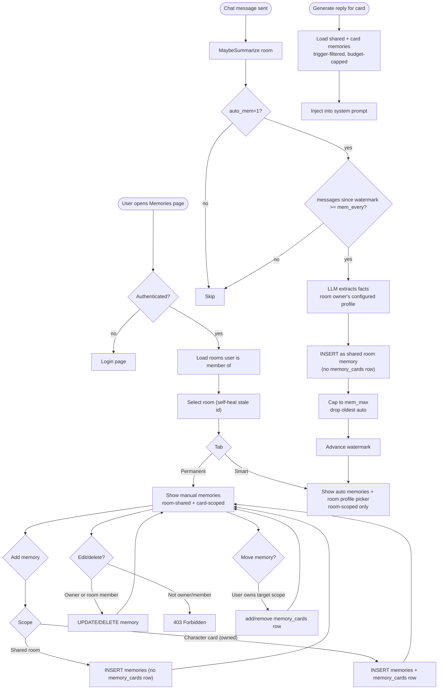

# Memories — Design & Flow

This document describes how the memories system in BOLLOCKS works, who can do
what, and the intended refinements. It accompanies the code in `src/db.js`,
`src/server.js`, `src/generate.js`, `public/memories.html`, and `public/app.js`.

## Concepts

There are two kinds of memory, distinguished by `origin`:

| Kind | `origin` | Created by | Scope | Lifetime |
|---|---|---|---|---|
| **Permanent** | `user` | User (always user-driven) | Room-shared or character (card) | Until user deletes it |
| **Smart** | `smart` | AI extraction | **Room only** (shared) | Capped (`mem_max`); oldest auto dropped |

### Permanent memories (user-driven)

- Created explicitly by a user through the Memories UI or API.
- `type` defaults to `fact`; user can set `fact` / `event` / `relationship` / `preference`.
- `triggers` empty = always inject; otherwise keyword-gated.
- **Ownership / edit rights:**
  - A user may edit/delete **character memories** for cards they **own** (`cards.owner_users_id_fk === user`).
  - A user may edit/delete **room (shared) memories** for any room they are a **member of**.
  - Permanent memories are never auto-created, never auto-capped, never auto-deleted.
- Card-scoped permanent memories travel with that character **within the room(s)** they were created in (linked via `room_memories` + `memory_cards`).

### Smart memories (AI-extracted)

- Created automatically by `maybeSummarize()` after every `mem_every` messages when `auto_mem=1`.
- **Profile link:** a room follows a smart-memory profile via `rooms.mem_profiles_id_fk`. Profiles stay user-owned presets (`mem_profiles.users_id_fk`); a room may only follow a profile owned by the room's owner, and only the room owner can change the link (`POST /api/room/memsettings`). When the link is unset, the room falls back to the room owner's first profile — never another user's. Deleting a profile re-points only the owner's own rooms at another of their profiles.
- Extraction runs only through the room owner's configured extraction profile (`mem_extraction_profile_id` on the memory profile). No fallback: if it is unset, missing, or belongs to someone other than the room owner, extraction is skipped.
- **Smart memories belong to the chat (room) only** - they are always stored as shared room memories (no `memory_cards` row).
  - Rationale: deciding whether an extracted fact belongs to a specific character vs. the chat as a whole is ambiguous and error-prone. Keep smart memories room-scoped; users can promote a fact to a character's permanent memory manually if desired.
- Capped to `mem_max` per room (oldest `origin='smart'` dropped). Permanent memories are never subject to the cap.
- Watermark (`mem_last_messages_id`) advances only after a successful extraction.

## Scoping model

```
memory (memories)  -- standalone entity; no room/card FKs
├── origin  'user' | 'smart'
├── room_memories (junction, many-to-many)  -- which chats this memory is available in
│   └── rooms_id_fk → room
└── memory_cards (junction, many-to-many)  -- which characters this memory belongs to
    └── cards_id_fk → card (character memory; absent => shared room memory)
```

- A memory is **shared room memory** iff it has no `memory_cards` row.
- A memory is **character memory** iff it has one or more `memory_cards` rows.
- A memory can span multiple rooms (cross-chat) and multiple cards.
- Smart memories are room-scoped (linked to one room) by design.

Injection at generation time (see `generateReply`):
1. Shared room memories (no `memory_cards` row, trigger-filtered, budget-capped).
2. This card's own memories (linked via `memory_cards`, trigger-filtered, budget-capped against remaining budget).
3. Budget = `rooms.mem_budget` tokens.

## Ownership & permissions

| Action | Permanent (manual) | Smart (auto) |
|---|---|---|
| Create | User (via UI/API) | System (extraction) |
| Read | Room members / card owners | Room members |
| Edit content/type/triggers | Card owner or room member | No (read-only; regenerate via extraction) |
| Delete | Card owner or room member | Room member (or auto-capped) |
| Move between scopes (card ↔ shared) | User (via move) | No |

**Room membership** is determined by `room_members` (junction) plus the room's existence. A user is considered a member of a room if they appear in `room_members` for that room, or are the room owner/creator.

## Flow chart



## API contract (intended)

| Endpoint | Method | Auth | Notes |
|---|---|---|---|
| `/api/memories?card=&room=` | GET | user | List memories. `card=-1` all in room; `card=0` shared only; `card>0` that card. |
| `/api/memories` | POST | user + ownership | Create. `{cardId, room, content, type?, triggers?}`. `cardId=0`/null = shared. Requires card ownership or room membership. |
| `/api/memories/delete` | POST | user + ownership | `{id}`. Delete if owner/member. |
| `/api/memories/update` | POST | user + ownership | `{id, content?, type?, triggers?}`. |
| `/api/memories/move` | POST | user + ownership | `{id, cardId}`. Move between card and shared. |
| `/api/room/memsettings` | POST | room owner only | `{room, memProfile}`. Point the room at one of the owner's own `mem_profiles` (0 clears). |
| `/api/lastmem?room=` | GET | user | Latest `origin='smart'` memory in room. |

## Known issues to fix (tracked)

1. `/api/memories/delete`, `/triggers`, `/move` read `b.world_books_id_pk` instead of `b.id` — mismatched with frontend. Fix to `b.id`.
2. `/api/memories/triggers` filters by `rooms_id_pk` instead of `memories_id_pk` — would update all memories in a room. Fix filter.
3. No ownership/auth checks on memory endpoints or memsettings. Add per the table above.
4. Smart extraction stores everything as shared (strips `[Name]`) — acceptable per design; document it.
5. ~~Extraction profile (`set_profile`) not persisted~~ — resolved: `mem_extraction_profile_id` on the memory profile is used, and it must belong to the room owner (no fallback).
6. `POST /api/memories` doesn't accept `type`/`triggers` from frontend.
7. Consider adding `updated` timestamp and `owner_users_id_fk` for audit.

## Open design questions

- Should permanent card memories be visible across rooms if the same card is in multiple rooms? Currently scoped per room. Leaning: keep per-room (matches smart memories; avoids cross-room leakage).
- Should smart memories ever be attributed to a character? Decided no — room-scoped only, to avoid ambiguity. Users can promote manually.
- Should there be a "global character memory" (ST-style)? Deferred; would need a memory with no `room_memories` link + UI scope selector.
