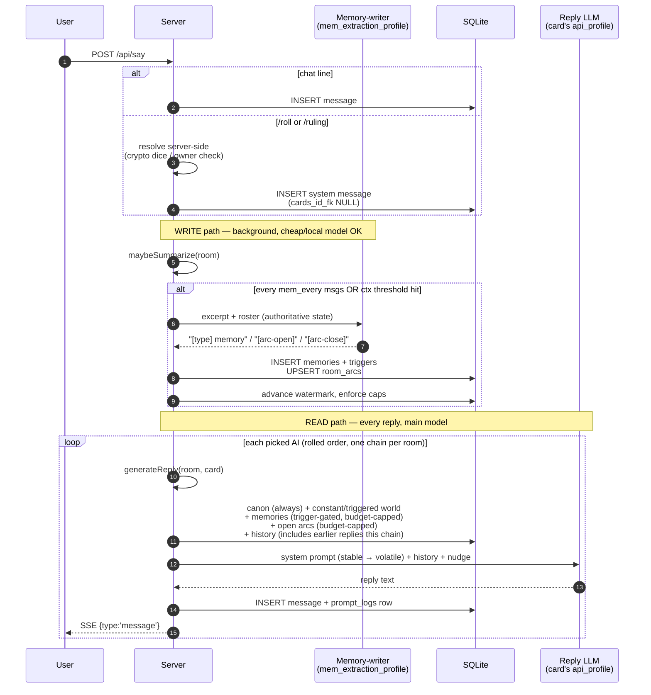

# Memories — Design & Flow

This document describes how the memories system in BOLLOCKS works, who can do
what, and the intended refinements. It accompanies the code in `src/db.js`,
`src/server.js`, `src/generate.js`, `public/memories.html`, and `public/app.js`.

## Concepts

There are two kinds of memory, distinguished by `origin`:

| Kind | `origin` | Created by | Scope | Lifetime |
|---|---|---|---|---|
| **Permanent** | `user` | User (always user-driven) | Room-shared or character (card) | Until user deletes it |
| **Smart** | `smart` | AI extraction | **Room only** (shared) | Capped (`mem_max`); oldest auto dropped |

### Permanent memories (user-driven)

- Created explicitly by a user through the Memories UI or API.
- `type` defaults to `fact`; user can set `fact` / `event` / `relationship` / `preference`.
- Trigger keywords live as `memory_triggers` rows (one per word, lowercase); no rows = always inject, otherwise keyword-gated. The API speaks comma-separated strings at the boundary.
- Matching is whole-word over the full fetched history + the generating card's fields (`wordHit` in `generate.js`, shared with world entries): `"king"` fires on `"kings"`/`"king's"` but not inside `"looking"`. No substring matching.
- **Ownership / edit rights:**
  - A user may edit/delete **character memories** for cards they **own** (`cards.owner_users_id_fk === user`).
  - A user may edit/delete **room (shared) memories** for any room they are a **member of**.
  - Permanent memories are never auto-created, never auto-capped, never auto-deleted.
- Card-scoped permanent memories travel with that character **within the room(s)** they were created in (linked via `room_memories` + `memory_cards`).

### Smart memories (AI-extracted)

- Created automatically by `maybeSummarize()` after every `mem_every` messages, when the room follows a profile.
- **Profile link:** a room follows a smart-memory profile via `rooms.mem_profiles_id_fk` — **the link itself is the on/off switch** (the profile dropdown; the old `auto_mem` column has been dropped). Profiles stay user-owned presets (`mem_profiles.users_id_fk`); a room may only follow a profile owned by the room's owner, and only the room owner can change the link (`POST /api/room/memsettings`). No link → smart memories are **off** (no fallback to a default profile). Deleting a profile re-points only the owner's own rooms at another of their profiles.
- Extraction runs only through the room owner's configured extraction profile (`extraction_api_profiles_id_fk` on the memory profile). No fallback: if it is unset, missing, or belongs to someone other than the room owner, extraction is skipped.
- **Smart memories belong to the chat (room) only** - they are always stored as shared room memories (no `memory_cards` row).
  - Rationale: deciding whether an extracted fact belongs to a specific character vs. the chat as a whole is ambiguous and error-prone. Keep smart memories room-scoped; users can promote a fact to a character's permanent memory manually if desired.
- Capped to `mem_max` per room (oldest `origin='smart'` dropped). Permanent memories are never subject to the cap.
- Watermark (`mem_last_messages_id_fk`) advances only after a successful extraction.

## Scoping model

```
memory (memories)  -- standalone entity; no room/card FKs
├── origin  'user' | 'smart'
├── room_memories (junction, many-to-many)  -- which chats this memory is available in
│   └── rooms_id_fk → room
└── memory_cards (junction, many-to-many)  -- which characters this memory belongs to
    └── cards_id_fk → card (character memory; absent => shared room memory)
```

- A memory is **shared room memory** iff it has no `memory_cards` row.
- A memory is **character memory** iff it has one or more `memory_cards` rows.
- A memory can span multiple rooms (cross-chat) and multiple cards.
- Smart memories are room-scoped (linked to one room) by design.

Injection at generation time (see `generateReply`):
1. Shared room memories (no `memory_cards` row, trigger-filtered, budget-capped).
2. This card's own memories (linked via `memory_cards`, trigger-filtered, budget-capped against remaining budget).
3. Budget = `rooms.mem_budget` tokens.

## Ownership & permissions

| Action | Permanent (manual) | Smart (auto) |
|---|---|---|
| Create | User (via UI/API) | System (extraction) |
| Read | Room members / card owners | Room members |
| Edit content/type/triggers | Card owner or room member | No (read-only; regenerate via extraction) |
| Delete | Card owner or room member | Room member (or auto-capped) |
| Move between scopes (card ↔ shared) | User (via move) | No |

**Room membership** is determined by `room_members` (junction) plus the room's existence. A user is considered a member of a room if they appear in `room_members` for that room, or are the room owner/creator.

## Flow chart


## API contract (intended)

| Endpoint | Method | Auth | Notes |
|---|---|---|---|
| `/api/memories?card=&room=` | GET | user | List memories. `card=-1` all in room; `card=0` shared only; `card>0` that card. |
| `/api/memories` | POST | user + ownership | Create. `{cardId, room, content, type?, triggers?}`. `cardId=0`/null = shared. Requires card ownership or room membership. |
| `/api/memories/delete` | POST | user + ownership | `{id}`. Delete if owner/member. |
| `/api/memories/update` | POST | user + ownership | `{id, content?, type?, triggers?}`. |
| `/api/memories/move` | POST | user + ownership | `{id, cardId}`. Move between card and shared. |
| `/api/room/memsettings` | POST | room owner only | `{room, memProfile}`. Point the room at one of the owner's own `mem_profiles` (0 clears). |
| `/api/lastmem?room=` | GET | user | Latest `origin='smart'` memory in room. |

## Known issues to fix (tracked)

1. `/api/memories/delete`, `/triggers`, `/move` read `b.world_books_id_pk` instead of `b.id` — mismatched with frontend. Fix to `b.id`.
2. `/api/memories/triggers` filters by `rooms_id_pk` instead of `memories_id_pk` — would update all memories in a room. Fix filter.
3. No ownership/auth checks on memory endpoints or memsettings. Add per the table above.
4. Smart extraction stores everything as shared (strips `[Name]`) — acceptable per design; document it.
5. ~~Extraction profile (`set_profile`) not persisted~~ — resolved: `extraction_api_profiles_id_fk` on the memory profile is used, and it must belong to the room owner (no fallback).
6. `POST /api/memories` doesn't accept `type`/`triggers` from frontend.
7. Consider adding `updated` timestamp and `owner_users_id_fk` for audit.

## Open design questions

- Should permanent card memories be visible across rooms if the same card is in multiple rooms? Currently scoped per room. Leaning: keep per-room (matches smart memories; avoids cross-room leakage).
- Should smart memories ever be attributed to a character? Decided no — room-scoped only, to avoid ambiguity. Users can promote manually.
- Should there be a "global character memory" (ST-style)? Deferred; would need a memory with no `room_memories` link + UI scope selector.

## Canon & arcs

The `.ph` sections on the Memory profiles settings page sketch a richer
memory system. Two of them — **canon** and **arcs** — are implemented
end-to-end. UI structure: the Memories page has **Manual** (permanent) and
**Smart** (extracted) tabs, and story threads live on their own **Stories**
page with the same Manual/Smart split (by who opened them). Designed for
minimal API cost.

Terms: **canon** = always-true facts ("never contradict this") — defined
mechanically as a memory with **no trigger keywords**, not a flag; **arcs** =
open story threads with a lifecycle ("this is unfolding — advance it").
Canon is static; arcs open, progress, close.

**Scene state** = `type='state'` smart memories holding a "what is true
right now" snapshot — locations, held objects, ongoing conditions. A
dedicated memory-writer pass (`mem_state` on the profile, every
`mem_state_every` extraction runs, paced by `rooms.mem_extract_count`)
rewrites the snapshot wholesale: the previous `[state]` rows are deleted,
not accumulated. State rows carry no triggers, never fold into arcs, are
excluded from the canon query and the global `mem_max` cap, and inject as
their own `Scene:` prompt block (capped by `mem_state_budget`).

### Who does what

Two cost centers behave differently: **generation calls** (background LLM
jobs — a cheap/local profile works fine) and **injection** (every prompt block
bills input tokens on the *main* model every reply — only budgets control it).



Canon lives entirely in the read path — pure SQL, no model call. Arcs exist
on both sides: written by the memory-writer, injected on every reply.

### Conflict resolution conventions

Multiplayer rooms can contradict themselves — two humans describe the same
thing differently, or an outcome is genuinely contested. The convention, in
precedence order:

1. **Rulings win.** `/ruling <decision>` (room owner only) posts a system
   message `Ruling: …` that extraction and the scene-state pass treat as
   authoritative.
2. **Rolls settle contests.** `/roll NdS±K [vs TARGET]` is resolved by the
   server (`node:crypto`, not the model) and posted as a system message like
   `Blake rolls 1d20+5 → 17 (12 + 5) vs 15 — success`. The command line
   itself is never stored — the *result* is the chat history.
3. **Recency wins otherwise.** Ordinary contradictions resolve to the most
   recent message — both extraction prompts state this explicitly.

System messages flow through the same pipeline as normal chat: SSE fan-out,
AI triggers, memory extraction, scene snapshots — a ruling or roll result
reaches context exactly the way a spoken line does.

### Schema

```sql
-- canon is "no memory_triggers rows" — no flag column. A user_version=8
-- migration clears triggers off rows from the old canon=1 era so they
-- stay always-injected; the column itself is then dropped.
ALTER TABLE mem_profiles ADD COLUMN mem_canon_budget INTEGER DEFAULT 800;

CREATE TABLE IF NOT EXISTS room_arcs (
    room_arcs_id_pk INTEGER PRIMARY KEY AUTOINCREMENT,
    rooms_id_fk INTEGER NOT NULL REFERENCES rooms(rooms_id_pk),
    title TEXT NOT NULL,
    summary TEXT DEFAULT '',           -- writer updates as it progresses
    status TEXT DEFAULT 'open'
        CHECK(status IN ('open','resolved','dropped')),
    origin TEXT DEFAULT 'user' CHECK(origin IN ('user','smart')),
                                   -- 'user' (Stories page) | 'smart' (extraction)
    opened_messages_id_fk INTEGER REFERENCES messages(messages_id_pk) ON DELETE SET NULL,
    closed_messages_id_fk INTEGER REFERENCES messages(messages_id_pk) ON DELETE SET NULL,
    created TEXT DEFAULT (datetime('now')),
    updated TEXT DEFAULT (datetime('now'))
);

ALTER TABLE mem_profiles ADD COLUMN mem_max_arcs INTEGER DEFAULT 10;
ALTER TABLE mem_profiles ADD COLUMN mem_arc_budget INTEGER DEFAULT 700;
ALTER TABLE mem_profiles ADD COLUMN arc_api_profiles_id_fk INTEGER
    REFERENCES api_profiles(api_profiles_id_pk) ON DELETE SET NULL;
-- NULL = share extraction_api_profiles_id_fk; non-NULL = dedicated pass
-- (reserved, must still belong to the room owner). NULLed on
-- api_profile/user delete.
```

All additive in `migrateSchema()`; the new `mem_*` columns ride
`MEM_PROFILE_FIELDS`; `room_arcs` is covered by `deleteRoomCascade`.

### Canon (injection-only, no extra LLM calls)

- **Canon = no trigger keywords.** A memory with an empty trigger list is
  always injected; adding keywords makes it contextual. There is no flag —
  clearing the triggers field in either page's editor is how you promote a
  memory (works for both `origin='user'` and `origin='smart'`).
- `generateReply` injects canon under the `canon` PROMPT_BLOCKS key (default
  position: after `roster`, before `world` — very stable, cache-friendly).
  Bypasses the `mem_refresh` counter; capped by `mem_canon_budget`.
  Untriggered rows are excluded from the regular memory block so they don't
  inject twice (the regular block now requires ≥1 trigger row). Shared canon
  + the card's own apply.
- Display: untriggered rows get a `canon` badge in the lists; the editor's
  triggers field carries an "empty = canon" placeholder.
- Caps note: canon smart memories still count toward the per-type/`mem_max`
  eviction caps — promote truly permanent facts to `origin='user'` (→ manual).

### Arcs (room_arcs + [arc\*] extraction tags)

- Routes: `GET /api/arcs?room=`; `POST /api/arcs` / `arcs/update` /
  `arcs/resolve` / `arcs/delete` — all `roomMember`-gated. `origin` splits the
  Stories page tabs: `user` rows come from the API, `smart` rows from
  `[arc-open]` extraction tags.
- Injection: open arcs render under the `arcs` PROMPT_BLOCKS key (default:
  after `memories`), `title — summary` per line, capped by `mem_arc_budget`.
- Extraction: when `mem_max_arcs > 0`, the built-in extraction prompt gains
  `MEM_ARCS_SUFFIX` plus the room's current open titles for grounding.
  `[arc-open] Title — summary` inserts/updates, `[arc] Title — beat` updates
  the summary, `[arc-close] Title` resolves — matched case-insensitively on
  title. Arc lines coexist with the single memory bullet: extra memory lines
  are still ignored, but the scan no longer stops at the first bullet.
- Open arcs over `mem_max_arcs` drop to `dropped`, least-recently-touched
  first.
- **Consolidation (`consolidateArc`)** — when an arc leaves `open` (resolve,
  drop-by-cap, `[arc-close]`, or `arcs/update` status change), a chronicler
  pass summarizes the arc's message span (open→close anchors, head+tail
  truncated) into `room_arcs.summary`, then folds `origin='smart'` memories
  created during the span under it via `memories.room_arcs_id_fk`
  (`ON DELETE SET NULL` — deleting an arc unfolds them). Only triggered
  memories fold; canon stays top-level. The call uses
  `arc_api_profiles_id_fk`, falling back to `extraction_api_profiles_id_fk`,
  owner-owned as usual — no profile configured = consolidation off.
- Injection: closed arcs with summaries render `Earlier events:` under the
  same `arcs` block when a title word reappears in context **or** a folded
  memory's trigger fires — matching details ride under the headline as
  indented sub-lines. Folded memories never inject standalone, so a closed
  chapter's details collapse into one line until re-evoked.

### Parser fix folded in

Leading `[tag]` stripping now loops (up to 3 tags): type tags set `type`,
`[arc*]` tags drive `room_arcs`, anything else (`[Name]`/`[shared]`) is
stripped. The old single-strip order flattened every
`[event]`/`[preference]`/`[relationship]` line to `fact` — types now land
correctly.

### Open decisions

- Canon semantics — settled: **untriggered = canon** (no flag, no separate
  concept). Chosen over an explicit flag after the "scar doesn't need
  injecting every turn" critique — keyword gating stays the relevance
  mechanism, canon is just its absence.
- Arc `summary` overwrite vs. append — overwrite for now (one line per arc,
  cheap injection); a beats timeline would need its own cap.
- `arc_api_profiles_id_fk` — now drives `consolidateArc` (chapter summaries
  on close), with `extraction_api_profiles_id_fk` as fallback. Still unused
  for a separate arc *extraction* pass; add if tag-folding proves unreliable.
